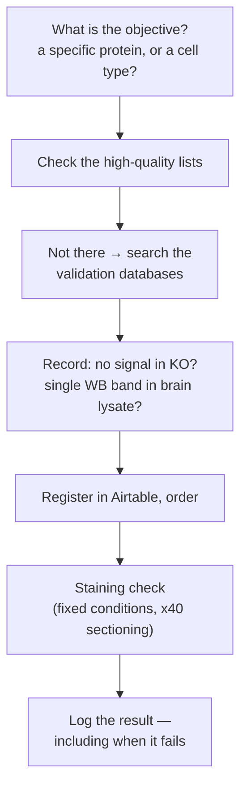

# Choosing, buying and validating antibodies

How to pick a primary antibody, how to check it works, and what has already been
tested in this lab.

Last update: 2026-10-28 (followed the rename of `ai-resource-access-YYYYMMDD.md` to `ai-resource-access-20261028.md`; no step changed)

**Antibody registry: [Airtable](https://airtable.com/appBe0vkVHeghLPhL).** Search
it before you buy anything.



## Why this matters

- **Antibody non-specificity is a real and widespread problem.** An antibody
  having been used in a published paper does not mean it is specific
- Using an unvalidated antibody leads to wrong conclusions and wasted material
- **In IHC, polyclonals generally outperform monoclonals** — but they carry
  batch-to-batch variability, more cross-reactivity, and a finite, non-renewable
  supply. ([Thermo: monoclonal vs polyclonal](https://www.thermofisher.com/jp/ja/home/life-science/antibodies/primary-antibodies/monoclonal-vs-polyclonal-antibodies.html))
- **Few antibodies work as expected in IHC.** Many need protocol optimisation and
  some never work at all
- **Record the antibodies and conditions that did NOT work, not just the ones
  that did.** Failure records are what stop the next person repeating the
  experiment, and they are worth sharing outside the lab too

## Validation methods

| Method | Advantage | Disadvantage |
| --- | --- | --- |
| **Staining disappears in KO mouse tissue** | Direct, in vivo, under physiological conditions. The strongest evidence | Slow and expensive to breed and maintain; ethical cost. Not usable for screening many antibodies |
| **Protein microarray** | Comprehensive specificity against known recombinant proteins; high throughput | The arrayed proteins may not be in native conformation; no biological context |
| **Overexpress the target in cells and stain** | Fast, in HEK cells or in tissue | Working under overexpression says nothing about detecting the endogenous protein |

Beyond these: RNAi/CRISPR knockdown, agreement between different clones,
immunoprecipitation + mass spec.

Quality ratings: [市販抗体格付けと3つ星抗体](https://ftrf.jp/antibody-validation/).

## Selection

**Start from the objective.** Identifying a specific protein and identifying a
cell type are different problems — for cell types, first list the candidate
proteins (Deep Research is useful here), then look for antibodies.

Things to check:

- **Has it been tested under conditions close to yours?** Mouse, brain, PFA
  fixation, the same buffer
- **Do you need multiplexing?** Then pick primaries raised in **different
  species** (mouse / rabbit / goat). (Same-species co-staining is sometimes
  possible with directly labelled antibodies; not covered here)

### Where to look, in order

1. **The high-quality lists**
   - [Nittobo NMD](https://nittobo-nmd.co.jp/reagents/product_list.html) —
     the Watanabe lab (Hokkaido University) antibodies
   - [3つ星抗体一覧](https://ftrf.jp/antibody-validation-list/)
   - [Synaptic Systems](https://www.sysy.com/)
2. **If it is not on those lists, search the databases**, and record two things
   for each candidate — **no signal in KO mice: yes / no / not available**, and
   **single WB band in brain lysate: yes / no / not available**
   - [Antibodypedia](https://www.antibodypedia.com/) — scored, validated antibodies
   - [BenchSci](http://www.benchsci.com) — analyses published figures for usage
     and validation data
   - [Bioz](http://www.bioz.com) — extracts antibody performance data from papers
   - [Antibody Registry](http://www.antibodyregistry.org) — RRIDs, for citing
     antibodies unambiguously
   - [Human Protein Atlas](http://www.proteinatlas.org) — **human only**
   - JCN Antibody Database
   - [Labome](https://www.labome.com/index.html) — validated antibody database
   - [Antibodies-online](http://www.antibodies-online.com/) — antibody list
   - [IHC World](http://www.ihcworld.com/) — IHC methods and antibody information
3. Deep Research also works for finding usage in papers

## Purchase

Register the antibody in **[Airtable](https://airtable.com/appBe0vkVHeghLPhL)**.
The older sheet is
[1st antibody list 2020_](https://docs.google.com/spreadsheets/d/1BZVToiz1w0KTpBj2gvB4jOha-iSt0OIwUq4HPKGj7j0/edit?gid=293299132#gid=293299132)
(L room shelf 4, or −30 °C).

## Staining check

Fixed conditions, so that different antibodies can be compared:

| | |
| --- | --- |
| Sample | PFA fixation, **50 µm** |
| Antibody | Record the dilution **and the absolute amount added** (µL or µg) |
| Mounting | Record the cover-glass thickness (No. 1 or other) |
| Imaging | Keyence **×40**, sectioning on, **Z stack 1 µm × 40**. Tiling optional |

Write it up as a parameter file — see
[immunostaining.md](immunostaining-YYYYMMDD.md#recording-the-parameters).

### Where the data goes

```
V:\histology_raw_data\Antibody_qc\prj_staining_check\
  Antibody_validation\prj_validation\cond_[ID]_Ch1-Ch2\
```

**Put the metadata in the sample folder name** — brain region, AAV. For an AAV
injected into PFC: `SampleXXX_PFC_333-CaMKII-GFP`. Anything more complicated
than that goes in a text file inside the folder.

> The two paths given in the source —
> `V:\histology_raw_data\Antibody_qc\prj_staining_check` and
> `V:\histology\Antibody_qc\prj_staining_check` (in the DARPP32×PV result) —
> **disagree about the top-level folder.** Check which one the QC data actually
> lives under before you write there.

## Log

### Established

| Target | What it labels | Parameter file |
| --- | --- | --- |
| **Iba1** | microglia | `param_Iba1_ver20260706` |
| **Ctip2** | neocortex L5 | [18_PFC_layer_characterization_IHC](https://docs.google.com/presentation/d/1a9K8ub-KjqBHGWtVq1NRhAQ_iTkJhDBsNXUy96OYGCw/edit) |
| **Satb2** | neocortex, pan-layer | same |
| **DARPP32 × PV** | striatal projection neurons × PV interneurons | `param_antiPV_antiDARPP32_202507` |
| **HA tag** | — | `param_HA-SA_ver20260309` |
| **SA** (streptavidin) | biotinylated protein, e.g. TurboID | same |

**DARPP32 × PV result** (EH064, 2025-07-08): anti-PV fluorescence in GPe,
striatum and cortex; anti-DARPP32 in striatum only; **no overlap between the two**
— which is the expected result and is what makes this the reference example.
Data: `V:\histology\Antibody_qc\prj_staining_check\cond_DARPP32-611520-PV-ab11427_DARPP32-PV\EH064_20250708`.
Reference images: [antigen_validation](https://drive.google.com/drive/u/0/folders/1JULNp4FPZNX-JsDrP_wZTMWRR8QvOmc2)
and [Ref Atlas Ab validation](https://docs.google.com/presentation/d/1aOeIf4yL1g_707iV4Q-RBODUKfGuJ_NK5ImQzh_EFjg/edit).

> **Iba1, HA and SA are marked "established, TODO describe later" in the source
> and have no written conditions.** The parameter files above are the only
> record. Someone who has run them should write the conditions down.

### In progress

| Target | Status |
| --- | --- |
| **V5 tag** | Anti-V5, rabbit. Nothing else recorded |
| **CD31** (blood vessels) | [Abcam ab24590](https://www.abcam.co.jp/products/primary-antibodies/cd31-antibody-p2b1-ab24590.html) (>300 citations; IHC-P, IHC-Fr, IF, flow; WB may need optimisation). Ref: [eNeuro 2019](https://www.eneuro.org/content/6/4/ENEURO.0448-18.2019#F6). [R&D AF3628](https://www.rndsystems.com/products/human-mouse-rat-cd31-pecam-1-antibody_af3628) ordered 2025-07-08 (Tajiri) — Antibodypedia top hit |
| **GFAP** (astrocyte) | Evaluating what is already in stock; if it looks marginal, buy the Hokkaido University ones (MSFR101820/830 Rb-Af800, 101840/850 Go-Af1000, 101860/870 GP-Af210; ¥36,750/20 µg, ¥68,250/50 µg) |
| **NeuN** | Evaluating what is already in stock |
| **ChAT** | Nothing recorded |

## Antibodies tested in this lab

Tested on the Keyence.

### Synapse markers

Homer is postsynaptic (PSD); bassoon is presynaptic (active zone).

| Target | Host | Isotype | Reactivity | Company | Catalogue | Clone | Fixation | Staining |
| --- | --- | --- | --- | --- | --- | --- | --- | --- |
| [Homer1](https://www.sysy.com/product/160003) | rabbit | IgG | mouse, rat, human | Synaptic Systems | 160 003 | — | 4% PFA | ◎ |
| [Homer1](https://www.abcam.co.jp/products/primary-antibodies/homer1-antibody-epr15309-ab184955.html) | rabbit | IgG | mouse, rat, human | Abcam | ab184955 | — | 4% PFA | ◎ |
| bassoon | mouse | IgG2aκ | mouse, rat | Enzo | ADI-VAM-PS003 | SAP7F407 | 4% PFA | ◎ |
| bassoon | mouse | IgG2a | mouse, rat, human | Abcam | ab82958 (¥88,000) | SAP7F407 | 4% PFA | ◎ |

Conditions: rabbit Homer and mouse bassoon at 1:100; anti-rabbit-Alexa488 and
anti-mouse-Alexa546 at 1:200.
**Synapse imaging needs a confocal with a high-NA objective** — the Keyence will
not resolve it.

### Cortical layer markers

| Target | Host | Isotype | Reactivity | Company | Catalogue | Clone | Fixation | Staining |
| --- | --- | --- | --- | --- | --- | --- | --- | --- |
| Satb2 | rabbit | IgG | mouse, rat, human | Abcam | ab92446 (¥32,000/20 µL) | EPNCIR130A | PFA | ◎ |

Tested against L5 neurons labelled with AAV L5-enhancer-Cre/DIO-Clover.
Reference: [Neuron 2008](https://www.cell.com/neuron/fulltext/S0896-6273%2807%2901017-3)
(E18.5 cortex).

### Glia markers

| Antibody | Reactivity | Host | Clone | Isotype | Price | Maker | Catalogue |
| --- | --- | --- | --- | --- | --- | --- | --- |
| GFAP | rat, human | mouse | G-A-5 | IgG1 | ¥88,400 | Sigma | G3893 |
| GFAP | rat, human | rabbit | poly | IgG | ¥27,800 | Sigma | G9269 |
| Iba1 | mouse, rat, human | rabbit | E4O4W | IgG | ¥40,000 | CST | #17198 |
| P2RY12 | mouse, rat | guinea pig | poly | — | ¥10,000 | Wako | 015-28871 |
| [MBP](https://www.biolegend.com/ja-jp/products/purified-anti-myelin-basic-protein-antibody-11469) | — | mouse | SMI99 | IgG2b, κ | ¥24,640 | Biolegend | 808403 |

Conditions used:

- Iba1 (CST, rabbit) 1:200 + anti-rabbit-Alexa488 1:500
- GFAP (Sigma, mouse) 1:200 + anti-mouse-Alexa546 1:500
- GFAP (rabbit) 1:200 + anti-rabbit-Alexa488 1:500; MBP (Biolegend, mouse)
  1:200 + anti-mouse-Alexa546 1:500
- P2RY12 (guinea pig) 1:200 + anti-guinea-pig-Alexa488/546/647 1:500

> The source lists this last secondary as "anti-rabbit" against a guinea pig
> primary, which cannot be right. **Check the actual secondary before repeating.**

### Tested by Kashiwagi in a previous lab

Not tested here, but known to work somewhere. Treat as leads, not as validated.

- **Neuronal:** NeuN (nuclei), MAP2 (somatodendritic), NFH (axon), CaMKIIα
  (excitatory), PV (inhibitory), SST (inhibitory), c-Fos (IEG), NPAS4 (IEG)
- **Synaptic:** PSD95, GluA2 (post); synaptophysin, synapsin 1, vGlut1, vGlut2,
  VGAT (pre)
- **Neuromodulator / peptide:** TH, serotonin, MCH, POMC, vasopressin, oxytocin, NPY
- **Tags:** GFP, dsRed/mCherry

## Marker genes by target

| Marker | Target (neocortex) / application |
| --- | --- |
| DAPI, Hoechst | DNA (A-T rich). Universal nuclear stain, all cell types |
| CaMKII | Cytosolic in excitatory neurons — soma and dendrites |
| VGlut1 (Slc17a7) | Presynaptic vesicles. Dense punctate labelling in the neuropil. Highly expressed in deep-layer excitatory neurons and in cortex-projecting excitatory neurons |
| VGlut2 (Slc17a6) | Excitatory neurons, thalamus |
| PSD-95 (Dlg4) | Postsynaptic density. Cytosolic + dendritic spine |
| MAP2 | Dendrites, all neurons |
| NeuN (Rbfox3) | Neuronal nuclei. General neuronal marker |
| GFAP | General astrocyte marker |
| GLAST | Astrocyte plasma membrane |
| Iba1 | General microglia marker |
| P2RY12 | Ramified microglia |

Suggested antibodies from the source:
[VGLUT1 MA5-31373](https://www.thermofisher.com/antibody/product/VGLUT1-Antibody-clone-CL2754-Monoclonal/MA5-31373) /
[48-2400](https://www.thermofisher.com/antibody/product/VGLUT1-Antibody-Polyclonal/48-2400);
[PSD-95 700902](https://www.thermofisher.com/antibody/product/PSD-95-Antibody-clone-23H23L19-Recombinant-Monoclonal/700902) /
[MA1-046](https://www.thermofisher.com/antibody/product/PSD-95-Antibody-clone-7E3-1B8-Monoclonal/MA1-046);
[GFAP PA1-10004](https://www.thermofisher.com/antibody/product/GFAP-Antibody-Polyclonal/PA1-10004) /
[53-9892-82](https://www.thermofisher.com/antibody/product/GFAP-Antibody-clone-GA5-Monoclonal/53-9892-82).

### Cortical layers

What the developmental literature says:

- **Cux2, Satb2** — upper layer
- **Ctip2** — deep layer
- **NeuN** — pan-layer

([Untangling Cortical Complexity During Development, 2018](https://journals.sagepub.com/doi/10.1177/1179069518759332))

For deep-layer pyramidal neurons in the **adult** mouse:

- **Ctip2** — L5-ET
- **Satb2** — upper layer, and L5-IT
- **Tbr1** — L6

([J Neurosci 2018](https://www.jneurosci.org/content/38/24/5441))

> **Open question carried over from the source: does Satb2 come back in L6?**
> The literature calls it an upper-layer marker, but images in the lab and from
> Maruyama show a much wider range of layers stained. One account has
> **Tbr1 and Ctip2 in the deep part of L6 and Satb2 in the upper part of L6**
> ([igakuken](https://www.igakuken.or.jp/public/news/048/cont7.html)). Not settled.

Also noted, unresolved: [Cell Reports 2017](https://www.cell.com/cell-reports/pdf/S2211-1247(17)31211-1.pdf)
found polyploid cells among rat L5 pyramidal neurons. PFC was not examined —
this may or may not be part of L5 diversity there.

### Astrocyte markers

There is a full comparative review of astrocyte markers —
[免疫組織化学染色アストロサイトマーカー比較](https://docs.google.com/document/d/1mgPF08Tn3zlDjX2d2PMB1wwrY58_9os2X3fQR65215g/edit)
— which **stays in Drive: it is generated by AI and its citations have not been
checked.** Read it as a starting point, not as a source. Its practical
conclusions, which match the primary literature it cites:

| Marker | Best for | Watch out for |
| --- | --- | --- |
| **GFAP** | Mature and **reactive** astrocytes; the standard for astrogliosis | Does not label many healthy grey-matter astrocytes, and does not label the fine processes. Also in ependymal cells and neural stem cells |
| **ALDH1L1** | **Pan-astrocyte** — labels the fine processes and many astrocytes GFAP misses. Best when you need the whole population | Also in radial glia during development |
| **S100B** | A biomarker of active neural injury | Also in oligodendrocytes, Schwann cells, ependymal cells, some neurons. Mostly labels the soma |
| **AQP4** | Perivascular endfeet, water homeostasis, glymphatics; the target antigen in NMOSD | Labels the endfeet, not the whole cell. Also in ependymal cells |
| **GLAST / GLT-1** | Glutamate homeostasis, excitotoxicity | Less specific than ALDH1L1; GLT-1 is transiently neuronal during development |
| **SOX9** | Nearly exclusive to adult astrocytes outside neurogenic regions | — |

**There is no single best astrocyte marker.** Which one is right depends on the
question, the brain region, the species and whether you care about resting or
reactive astrocytes — so use a panel, not one antibody.

## Archival: SP/ENK and D1/D2

Older antibody references, kept for traceability:

- D1/D2 IHC — EJN 24: 2246-2252, *Depolarization-induced…*: SP Chemicon AB1977;
  L-Met Chemicon AB5024; D1/D2 original
- J Chem Neuroanat, *Differential perikaryal localization of…*: D1 rat anti-D1
  D-187 Sigma; D2 rabbit poly AB5084P
- Neurosci Lett, *Cocaine induced…*: goat anti-D2 [D2DR(N-19), Santa Cruz,
  1:100]; guinea pig anti-prodynorphin (Abcam, 1:100)

## Next-generation affinity reagents

Not in routine use, but worth knowing about:

- **Chimeric antibodies** —
  [Absolute Antibody](https://absoluteantibody.com/our-technology/formats-we-have-made/chimeric-antibodies/),
  [why multiplex with them](https://blog.cellsignal.com/multiplex-chimeric-antibodies),
  [CST](https://www.cellsignal.com/browse?tab=product&search=chimeric&categories=Primary%20Antibodies),
  [Abcam](https://www.abcam.co.jp/search#q=chimeric)
- **Nanobodies / VHH** —
  [what is a nanobody](https://www.ptglab.com/news/blog/what-is-a-nanobody/),
  [Nat Methods 2018](https://www.nature.com/articles/s41592-018-0177-x)
- **Aptamers** —
  [Optimer binders](https://aptamergroup.com/optimer-binders/what-is-an-aptamer/),
  [bioRxiv 2023](https://www.biorxiv.org/content/10.1101/2023.09.18.558240v1)

## Scheduling

**What a plan needs from this protocol** — see
[protocol.md](../../research-guidelines/30-experiment/protocol.md#what-a-protocol-owes-the-plan).
**The row that matters here is `Wait after`, and it is empty.** Choosing an antibody is quick; getting it is not, and the delivery lead time is recorded nowhere — so an experiment that needs a new antibody has an unknown gate in front of it.

### Occupies
| | |
| --- | --- |
| **Unit** | **1 antibody** |
| **Hands-on** | **n/a for selection.** The staining check is a run of [immunostaining.md](immunostaining-YYYYMMDD.md#scheduling) under fixed conditions, and takes that protocol's time |
| **Session** | **n/a — see above** |
| **Batch** | **n/a** |
| **Books** | **L-room Keyence microscopy** for the staining check — **×40, sectioning on, Z stack 1 µm × 40** ([Staining check](#staining-check)). calendar_id: [ai-resource-access.md](../general/ai-resource-access-20261028.md#instrument-booking-calendars-resolution-table-for-ai) |

### Depends
| | |
| --- | --- |
| **Needs beforehand** | Register the antibody in **Airtable-Resource_Reagents** ([Purchase](#purchase)). For the staining check, PFA-fixed 50 µm sections |
| **Wait after** | **未確認 — the delivery lead time is not recorded anywhere.** This is the gate on any experiment that needs an antibody the lab does not already hold, and it cannot be planned around until somebody writes down what a typical order takes ([logistics.md](../../research-guidelines/30-experiment/logistics.md#count-the-lead-time-to-the-step-that-needs-the-resource)) |
| **Expires** | **未確認.** Lot expiry is not tracked — **Airtable-Resource_Reagents `Ab_Lot` has no physical-check date field** ([#71](https://github.com/ylabjp/general/issues/71)) |

### Constrains
| | |
| --- | --- |
| **Window** | **n/a** |
| **Repeat** | **n/a** |
| **Interruptible** | **n/a** |

## Known gaps

- No pass/fail criterion for a staining check
- Iba1, HA and SA are "established" with no written conditions
- The QC data path is given two different ways (see above)
- The marker-gene table in the source has empty *Image reference* and *ref.*
  columns for every row — there are no reference images attached to it

## Revision history

| Date | Change |
| --- | --- |
| 2026-08-25 | back-filled from git: 0227a4f. **Derived, not confirmed by a person** — see [protocol.md](../../research-guidelines/30-experiment/protocol.md#back-filled-dates). |

## Source

[histology_nlm](https://docs.google.com/document/d/1KtndBnJZxJSUV9PwgTtYsO23E3PUImZCMAaGiYRW1fs/edit)
§Antibody, §Antibody tested in ylab, §Cortical layer marker. Astrocyte marker
summary condensed from the AI report linked above.

