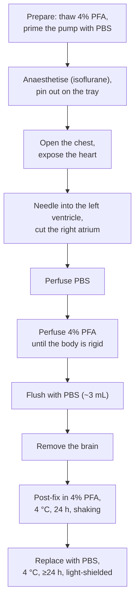
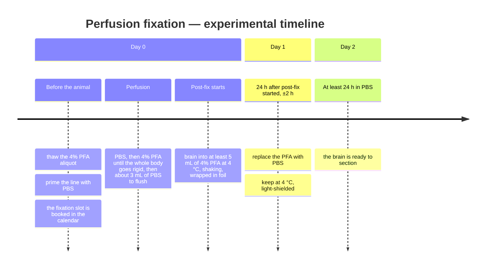

# Transcardial perfusion fixation

Fixing a mouse brain with 4% PFA so it can be sectioned and stained. This is the
first step of every histology experiment in the lab.

Last update: 2026-10-28 (followed the rename of `ai-resource-access-YYYYMMDD.md` to `ai-resource-access-20261028.md`; no step changed)

**Book the fixation slot in the calendar before you start.**

The bench work is one morning; the two 24 h holds after it are what actually
sets when the brain can be sectioned:

**Neither hold is a minimum you can shorten.** The post-fix is 24 h with ±2 h of
tolerance stated, and the PBS replacement is "at least" 24 h — so a brain
perfused on a Friday is sectionable on the Sunday at the earliest.

## Materials

### Opening the chest

- Scissors — ophthalmic scissors and gold-crown scissors
- Tweezers, forceps
- Isoflurane, and an anaesthesia container (a cotton-swab tub with swabs; a
  centrifuge tube with Kimwipes for maintenance)
- Fixation tray (a styrofoam lid) and needles to pin the mouse out
- Kim towels

### Perfusion

- Peristaltic pump
- Winged needle
- 1× PBS
- 4% PFA
- Tube for post-fixation
- Aluminium foil
- Oil-based pen
- Black plastic bag for disposal, contaminated-waste container

## Preparation

Set everything up **in the safety cabinet**.

- **Thaw the 4% PFA in advance.** Frozen 4% PFA aliquots are in the right-hand
  end of the −80 °C freezer, front left of the aliquot room
- Fill the post-fixation tube with about 8 mL of 4% PFA
- Cut the aluminium foil
- Fit the winged needle to the peristaltic pump tubing and prime the line with PBS

## Procedure

### 1. Anaesthetise and pin out

1. Put the mouse in the anaesthesia container
2. Once anaesthesia has taken hold, move it to the fixation tray and pin it down,
   keeping the anaesthesia going with the 10 mL tube

### 2. Open the chest

1. Longitudinal skin incision from the abdomen towards the head
2. Transverse incision across the abdomen at the xiphoid process, with forceps.
   Then a slightly deeper flank incision
3. Cut the diaphragm along the ribs and the sternum
4. Cut both sides of the sternum — **watch the heart**
5. Clamp the forceps towards the head so the chest stays open

### 3. Perfuse

1. Strip the fat and membrane off, hold the heart with tweezers, and put the
   needle into the **left ventricle**
2. Cut the **right atrium**
3. **Hold the needle in place until fixation is finished**
4. Pump ON — PBS
5. Pump OFF, move the inlet to the PFA
6. Pump ON — PFA. **Confirm the whole body goes rigid**
7. Pump OFF, move the inlet back to PBS
8. Pump ON — flush the PFA out with about 3 mL of PBS
9. Remove the needle and check the perfusion took: look at the liver and the
   fingertips

> **The two source documents give different volumes, and one gives a rate.**
>
> | | *Mouse brain fixation* | *histology_nlm* |
> | --- | --- | --- |
> | PBS | ≥10 mL, usually 12.5 mL | 15 mL |
> | 4% PFA | ≥10 mL, usually 12.5 mL | 12–15 mL |
> | Rate | not stated | 11 mL/min |
> | Post-fix | not timed | 24 h at 4 °C, shaking (±2 h) |
>
> Neither is marked as superseding the other. **Decide which one the lab is
> standardising on and write it here** — the PBS volume differs by 50%, which is
> not a rounding difference.

### 4. Remove the brain

1. Transverse incision at the neck
2. Longitudinal incision through the scalp up to the tip of the nose, exposing
   the skull
3. Cut the nasal cavity between the eyes with metal shears
4. Longitudinal incision above the olfactory bulb — **do not damage the brain**
5. Cut around the medulla oblongata
6. Expose the occipital bone and cut it — **do not damage the cerebellum**
7. Cut forward along the sagittal suture towards the nose. **Watch the scissor
   tips against the brain and the meninges**
8. Cut the nerves and connective tissue from the olfactory-bulb side
9. Once the brain is free of the skull, drop it into the post-fixation tube

### 5. Post-fix and store

1. **≥5 mL of 4% PFA, 4 °C, 24 hours, shaking.** Up to 2 hours either side is
   acceptable
2. Wrap the tube in aluminium foil to keep the light out
3. Replace the PFA with PBS and keep at 4 °C for **at least 24 hours** before
   sectioning
4. **Do not pour PFA down the drain** — it goes in the waste container

**Section as soon as the PBS hold is over. A fixed brain is not banked in PBS.**
Three things get worse the longer it sits at 4 °C, and none can be prevented
outright: **microbes grow, the buffer evaporates, and antigenicity is lost**. If a brain nevertheless has to be kept, put it in **PBS with sodium azide at
0.02 % (w/v) final concentration** and **seal the tube against evaporation
(Parafilm or equivalent)**. The azide concentration is the generally used
figure, not one measured here; sodium azide is acutely toxic, so azide-PBS goes
to the waste container, never down the drain (general practice). How long the
brain then keeps has not been set (decided 2026-09-12, closing the `Expires`
gap listed in [#286](https://github.com/ylabjp/general/pull/286)).

## Scheduling

**What a plan needs from this protocol** — see
[protocol.md](../../research-guidelines/30-experiment/protocol.md#what-a-protocol-owes-the-plan).
**The bench work is one morning; the two 24 h holds after it are what actually sets the date the brain can be sectioned.** Neither hold can be shortened.

### Occupies
| | |
| --- | --- |
| **Unit** | **1 mouse / 1 brain** |
| **Hands-on** | **One morning** for the bench work ([Timeline](#transcardial-perfusion-fixation)) |
| **Session** | **One morning**, then the holds run unattended |
| **Batch** | **未確認** |
| **Books** | **未確認** — no booking calendar is recorded for the perfusion bench. calendar_id: [ai-resource-access.md](../general/ai-resource-access-20261028.md#instrument-booking-calendars-resolution-table-for-ai) |

### Depends
| | |
| --- | --- |
| **Needs beforehand** | **≥5 mL of 4% PFA at 4 °C** per animal, plus the perfusion set and anaesthesia ([Materials](#materials)) |
| **Wait after** | **48 hours minimum before sectioning: 24 h post-fix in 4% PFA at 4 °C with shaking (±2 h tolerance), then at least 24 h in PBS at 4 °C, light-shielded** ([Post-fix and store](#5-post-fix-and-store)). **Neither hold is a minimum you can shorten** — a brain perfused on Friday morning is not sectionable before Sunday |
| **Expires** | **Section as soon as the PBS hold is over — a fixed brain is not banked** ([Post-fix and store](#5-post-fix-and-store)). Beyond the 24 h minimum, 4 °C storage brings microbial growth, buffer evaporation and loss of antigenicity. **If it must wait: PBS with 0.02 % sodium azide, sealed against evaporation**; how long it then keeps is **未確認** (decided 2026-09-12) |

### Constrains
| | |
| --- | --- |
| **Window** | **n/a** |
| **Repeat** | **n/a — terminal** |
| **Interruptible** | **The bench work, no** — the perfusion runs start to finish. **The two holds are the buffer**, and they are where a slipped schedule absorbs — **but only briefly: the brain is sectioned as soon as the PBS hold is over** (`Expires`) |

## Known gaps

- The perfusion volumes and rate are inconsistent between the two sources (see
  the table above)
- *Mouse brain fixation* does not state the post-fix duration; *histology_nlm*
  does. The 24 h figure above is from the latter
- Neither source says what to do when the perfusion visibly fails (blood left in
  the liver, body not rigid). In practice that brain is usually not usable for
  IHC, but the criterion is not written down
- **"As soon as possible" has no number, and neither does azide storage.** The
  2026-09-12 decision set the principle — section once the PBS hold is over, and
  use 0.02 % sodium azide with a sealed tube only when a brain must wait — but no
  day limit for either state

## Revision history

| Date | Change |
| --- | --- |
| 2026-09-12 | **Storage rule for the fixed brain added: section as soon as the PBS hold is over; if it must wait, PBS with 0.02 % sodium azide, sealed** — answers the `Expires` gap listed in [#286](https://github.com/ylabjp/general/pull/286). Perfusion steps unchanged |

## Source

- [Mouse brain fixation](https://docs.google.com/document/d/1GENYQ2UFvKgLU-H4mEauAvEUHsa9bKzWei3qgvY2smU/edit)
  — the materials, chest opening and brain removal steps
- [histology_nlm](https://docs.google.com/document/d/1KtndBnJZxJSUV9PwgTtYsO23E3PUImZCMAaGiYRW1fs/edit)
  §Slice preparation — the volumes, the 11 mL/min rate and the post-fix timing
- Both trace back to
  [脳固定関連マニュアル2020-](https://docs.google.com/document/d/1NCrc1uemAlXWfNj4K-SIKR55OnJAVq6IyfBbCmpauQ0/edit)

The step-by-step photographs in *histology_nlm* stay in Drive: the document is
24 MB and Drive refuses to export it in any format, so the images could not be
pulled out.

