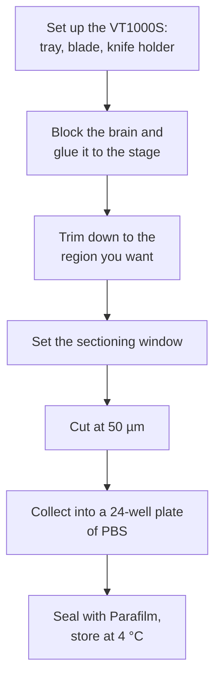

# Vibratome sectioning (Leica VT1000S)

Cutting 50 µm coronal sections from a PFA-fixed brain for free-floating
immunostaining.

Last update: 2026-10-28 (followed the rename of `ai-resource-access-YYYYMMDD.md` to `ai-resource-access-20261028.md`; no step changed)

Input: a brain that has been perfusion-fixed, post-fixed 24 h in 4% PFA, and
kept in PBS at 4 °C for at least another 24 h — see
[perfusion-fixation.md](perfusion-fixation-YYYYMMDD.md).

## Setting up the machine

1. Power on — **the switch is at the back**
2. Fit the buffer tray and fill it with 1× PBS
3. Assemble the knife holder and fit the blade
4. **Fix the knife holder with the screw that has three rings** — not the others
5. Speed **5**, FREQ **6**

## Mounting the brain

1. Have the fixed brain in a petri dish of 1× PBS
2. Position it so **the midline is in the centre**
3. Cut the block with a blade
4. **Cut the right side to leave a left/right landmark.** Once the brain is in
   the well plate there is nothing else to tell the hemispheres apart
5. Put a drop of superglue in the centre of the stage and set the block down on it
6. Fit the stage into the machine

## Sectioning

1. Bring the blade close to the brain with the UP/DOWN switch
2. Set the sectioning window: move the blade with REV/FORW and press the window
   button at each end
3. Trim down to the region you want, cutting with the start button
4. **Check the section thickness reads 50 µm**
5. Cut. Single stroke gives one section per press; continuous keeps cutting until
   you press START/STOP again

## Collecting and storing

1. Sections go into a 24-well plate filled with PBS
2. **Write the sample name and the date on the plate**
3. Seal the plate with Parafilm and store at 4 °C

## Cleaning up

1. Remove the machine parts
2. Wash the parts and everything you used, then rinse with milliQ
3. Put them back where they belong
4. Power off

## Reference

- Section inventory:
  [Airtable](https://airtable.com/appADyTIBWyaQe3D3/tblOxKX2x8Pg9bQrz/viwjOoPyTQ6fFJ4qN?blocks=hide)
- [Allen Mouse Brain Reference Atlas](https://mouse.brain-map.org/static/atlas)
  — for deciding and recording AP coordinates

## Scheduling

**What a plan needs from this protocol** — see
[protocol.md](../../research-guidelines/30-experiment/protocol.md#what-a-protocol-owes-the-plan).
**This step cannot start until the two fixation holds have run** — that is the 48 h in [perfusion-fixation.md](perfusion-fixation-YYYYMMDD.md#scheduling), not something this protocol can shorten.

### Occupies
| | |
| --- | --- |
| **Unit** | **1 brain** |
| **Hands-on** | **未確認** |
| **Session** | **未確認** |
| **Batch** | **未確認** |
| **Books** | **L-room Slicer (VT1000)** — this protocol is written for the Leica VT1000S. Duration **未確認**. calendar_id: [ai-resource-access.md](../general/ai-resource-access-20261028.md#instrument-booking-calendars-resolution-table-for-ai) |

### Depends
| | |
| --- | --- |
| **Needs beforehand** | **A brain perfusion-fixed, post-fixed 24 h in 4% PFA and kept in PBS at 4 °C for at least another 24 h** ([perfusion-fixation.md](perfusion-fixation-YYYYMMDD.md#5-post-fix-and-store)). 24-well plates filled with PBS to collect into |
| **Wait after** | **n/a — sections can go straight into staining.** They are collected into PBS in a 24-well plate ([Collecting and storing](#collecting-and-storing)) |
| **Expires** | **未確認.** Sections are sealed with Parafilm and stored at 4 °C, but no storage life is recorded |

### Constrains
| | |
| --- | --- |
| **Window** | **n/a** |
| **Repeat** | **n/a** |
| **Interruptible** | **未確認** |

## Known gaps

- **Section thickness is not uniform across the lab's protocols.** 50 µm is the
  standard here, but the 2019 AAV expression-check protocols used 100 µm and the
  antibody staining-check procedure specifies 50 µm. Whichever you use, record it
  in the staining parameter file
- No guidance on what to do when sections tear or come off the block mid-run

## Source

[histology_nlm](https://docs.google.com/document/d/1KtndBnJZxJSUV9PwgTtYsO23E3PUImZCMAaGiYRW1fs/edit)
§Slice preparation.

The source has a photograph at almost every step — buffer tray, knife holder,
the three-ring screw, blade position, the thickness readout, the labelled plate.
Those stay in Drive: the document is 24 MB and Drive refuses to export it, so the
images could not be extracted. **If you are doing this for the first time, open
the source alongside this file.**

