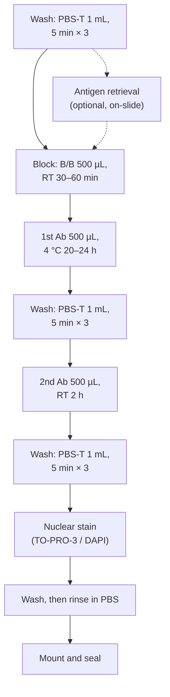
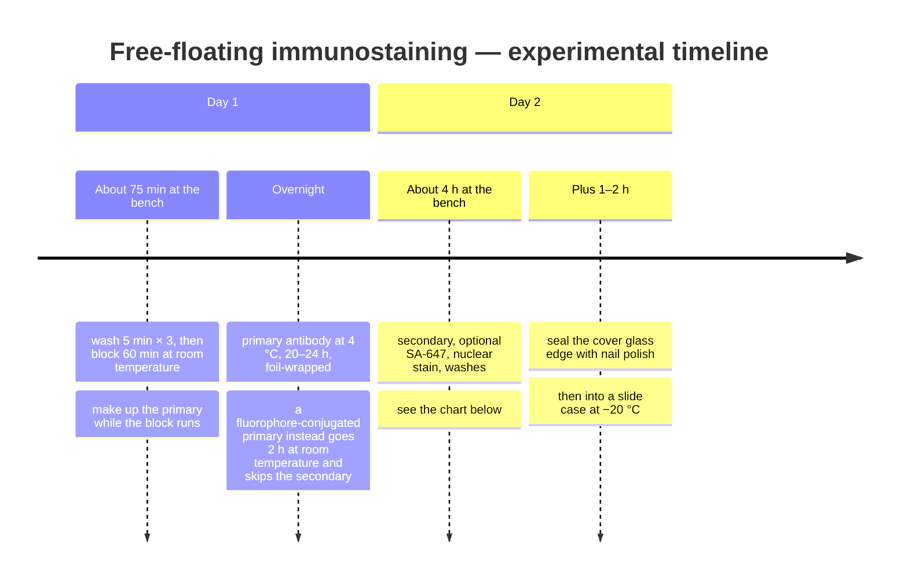

# Histology

# Free-floating immunostaining

The lab's standard IHC on 50 µm vibratome sections, from wash through mounting
and storage.

Last update: 2026-10-28 (followed the rename of `ai-resource-access-YYYYMMDD.md` to `ai-resource-access-20261028.md`; no step changed)

Input: 50 µm free-floating sections in PBS — see
[sectioning.md](sectioning-YYYYMMDD.md). Which antibody, at what dilution, and for how
long is decided per experiment and recorded in a **staining parameter file**;
see [Recording the parameters](#recording-the-parameters) below.

Across the clock that is two bench sessions with an overnight between them:

```mermaid
gantt
    title Day 2 — elapsed time from taking the plate off the primary
    dateFormat HH:mm
    axisFormat %H:%M
    section Room temperature, on the shaker
    Wash, PBS-T 1 mL, 5 min × 3        :w2, 00:00, 15m
    Secondary antibody, 500 µL         :crit, ab2, 00:15, 2h
    Wash, PBS-T 1 mL, 5 min × 3        :w3, 02:15, 15m
    SA-647 if used, 500 µL             :sa, 02:30, 1h
    Wash, PBS-T 1 mL, 5 min × 2        :w4, 03:30, 10m
    Nuclear stain, TO-PRO-3 at 1 to 1000 :nuc, 03:40, 30m
    section Mounting
    Final wash, PBS-T ×2 then PBS ×1, no duration stated :milestone, w5, 04:10, 0m
    Mount, lay the cover glass         :milestone, mnt, 04:10, 0m
    Wait before sealing                :seal, 04:10, 2h
    Seal with nail polish, store at −20 °C :milestone, fin, 06:10, 0m
```

The SA-647 hour is optional, so a run without it finishes an hour earlier.
**The wash count after the primary is unresolved** — 5 quick washes in one
source, 3 × 5 min in the other, and the chart follows the newer one. It is worth
settling, because five quick washes and three timed ones are not the same
experiment.

## Standard solutions

| | Solute | Solvent | Concentration |
| --- | --- | --- | --- |
| PBS-T | Triton X-100 | 1× PBS | 0.2% (v/v) |
| Blocking buffer (B/B) | Normal goat serum | PBS-T | 5% (v/v) |

- **Antibodies are diluted in B/B**, not in PBS-T
- Dilutions are in
  [Airtable](https://airtable.com/appADyTIBWyaQe3D3/tblAq5LlHYUuI7sNC/viwLaoRNQDArZc1NC?blocks=hide)
- **Match the serum to the secondary antibody's host, not the primary's.**
  Rabbit or mouse primary + goat secondary → 5% NGS. Goat primary + donkey
  secondary → 5% NDS, or 1% skim milk. **Never use NGS with a goat primary**

## Materials

- Sections (vibratome)
- Primary and secondary antibodies
- Nuclear stain: TO-PRO-3 (−30 °C, lower section, top-right box) or DAPI
- 1× PBS, PBS-T (0.2% Triton X-100)
- Blocking solution (4 °C, bottom right of the L room)
- NGS — VECTOR S-1000, 4 °C
- NDS — Fujifilm Wako 567-72351
- Optional: sodium citrate buffer, coated slides
- 24-well plates, droppers, pipettes, tubes, timer, aluminium foil
- Waste beaker (500 mL)

## Procedure

**Everything happens in a 24-well plate on a shaker. Everything except the
primary antibody reaction is at room temperature.**

1. **Wash** — PBS-T 1 mL, 5 min × 3
   - Change the solution without moving the sections between wells
   - Make up the B/B while this runs: allow about 2 mL per sample
2. **(Optional) Antigen retrieval** — see [below](#optional-antigen-retrieval)
3. **Block** — B/B 500 µL, 1 hour
   - The source notes 30 min is probably enough; one person in the lab always
     waits 60. **60 min is what is written as the standard here**
   - Make up the primary antibody solution while this runs
4. **Primary antibody** — 500 µL, **4 °C for 20–24 hours**
   - Remove the B/B thoroughly with a pipette first
   - Volume guide when you deviate from 500 µL: 1–2 sections/400 µL,
     3 sections/500 µL, 4 sections/600 µL
   - Cover and wrap in aluminium foil
   - **A fluorophore-conjugated primary can instead go 2 hours at room
     temperature** — and then steps 5 and 6 are skipped
5. **Wash** — PBS-T 1 mL, 5 min × 3
   - Make up the secondary antibody solution while this runs
6. **Secondary antibody** — 500 µL, **room temperature, 2 hours**
   - Use a fresh well
   - Secondary antibody stock sometimes dries out; redissolve it in B/B or PBS
7. **Wash** — PBS-T 1 mL, 5 min × 3
8. **(If using) SA-647** — 500 µL, 1 hour, then PBS-T 1 mL 5 min × 2
9. **Nuclear stain** — TO-PRO-3 diluted 1:1000 in PBS-T, 15–30 min
10. **Final wash** — PBS-T × 2, then PBS × 1, and go straight on to mounting

> **The source gives the wash count two different ways.** The *Basic operation*
> section says **5 washes** after the primary (first two changed immediately,
> then every 5 minutes); the *Practical guide* says **3 × 5 min**. The practical
> guide is the newer of the two and is what the procedure above follows.
> **This needs settling** — five quick washes and three timed ones are not the
> same experiment.

### (Optional) Antigen retrieval

Not required for PFA-fixed mouse brain, but it helps for some targets — pepsin
treatment for PSD proteins, for instance, and it is standard for peptides such as
substance P and enkephalin.

1. Mount the section on a **coated** slide
2. Prepare sodium citrate buffer, 10 mM, pH 6.0, in a small beaker
3. Submerge the slide and boil in a microwave for 10 min total: stop the
   microwave when it boils, restart, and repeat until 10 minutes of hot
   (~90 °C) has accumulated
4. Cool 15–20 min at room temperature
5. Wash twice in PBS-T, 5 min
6. **From here the staining happens on the slide**, not free-floating. Ring the
   section with a DAKO pen

References: [Synaptic Systems antigen-retrieval protocols](https://sysy.com/protocols/protocol-agr),
and [a simple and sensitive method for free-floating and slide-mounted sections](https://www.sciencedirect.com/science/article/abs/pii/S0165027099001429)
(J Neurosci Methods 1999) for peptides.

## Mounting and sealing

Done mainly in the L room. **Record the date on the fixation/IHC request table
when you are finished.**

### Materials

- Slides — MAS-coated (Matsunami MAS-0415)
- Cover glass — 25 × 36 mm (Matsunami)
- Mounting medium — VECTASHIELD, VECTOR H-1000, 4 °C. **This one has no DAPI**
- Droppers, 1× PBS, brush, tweezers, oil-based pen, nail polish, paper, tubes,
  magnifying glass

### Procedure

1. Bring the VECTASHIELD to room temperature before you start
2. Confirm the section layout the requester asked for
3. Label the slide — do this during the TO-PRO-3 incubation to save time
4. Transfer the section onto the slide with a dropper, spread it with a brush
5. Adjust the orientation under the magnifying glass if needed; use the light
   reflection to check for scratches in transmission
6. Wipe off the moisture with paper
7. Transfer as many sections as you need, leaving room for tiling and spacing
8. Put the mounting medium on the **cover glass** (check whether it contains
   DAPI; it should be at room temperature)
9. Hold the cover glass edge with tweezers and lay it down **without trapping
   bubbles**
10. Once the medium has spread, lay paper on top face-down to push out the
    excess and any air
11. After 1–2 hours, clean around the cover glass and seal the edge with nail
    polish
12. **Store the slides in a slide case at −20 °C** (one source says −30 °C in
    the L room; see the note below)

### Slide layout

The main manual only says "order by AP, left to right". The parameter files spell
it out, and the geometry matters because it decides how many tiles the imaging
takes:

- **Lay the coronal section's midline (the DV axis) along the slide's short
  edge.** The sections then line up in the short-edge direction
- **The notch is in the upper left of the right hemisphere** (from
  [sectioning.md](sectioning-YYYYMMDD.md) — you cut the right side as a landmark).
  **Mount with the notched hemisphere on the left**
- **2 sections per slide**, aligned along the short edge
- **The larger AP coordinate goes on the label side**

> **Check this against how the slide is loaded on the Keyence**, which wants the
> **larger AP on the right** with the glass face down
> ([microscopy/keyence-bz-x810.md](equipment/keyence-bz-x810-YYYYMMDD.md#placing-the-slide)).
> Whether "label side" and "right in the holder" are the same end depends on
> which way round the slide goes in. **Nothing written down resolves it** — check
> once on a real slide and then write the answer here.

Nail polish is dried **in the designated box** (room temperature, light-shielded).

### Working scale

- 24-well plate, **2 sections per well**
- **6 wells at a time = 3 mice**
- **Do not stack the 24-well chambers** during the primary antibody reaction.
  Use the shaker in the L room or the cold room

### Where the reagents are

| | |
| --- | --- |
| NGS (VECTOR S-1000) | L room, 4 °C, lower shelf — use the aliquots |
| DAPI | L room, 4 °C, lower shelf — aliquot your own |
| TO-PRO-3 | −30 °C, lower section, top-right box |
| Blocking solution | L room, 4 °C, bottom right |
| 1st antibody list | L room shelf 4, or −30 °C |
| 2nd antibody list | L room, −30 °C |
| Finished slides | L room, −30 °C freezer |

**Make up your own PBS and PBS-T.**

> **If you use DAPI, use DAPI solution (1:1000 in PBS-T, RT, 30 min) — not a
> DAPI-containing mounting medium.** VECTASHIELD comes both ways; the parameter
> files are explicit that the staining step is where the DAPI goes.

### Labelling rules

- **Label every slide with a TEPLA-printed ID, even when the MP number is the
  same.** Template:
  [LEPRA for IHC slide labeling.lw1](https://drive.google.com/file/d/1Q7wp0ptswJ14Hw3WOQ13NLeq8ivLsWvm/view)
- **Write the mounting date on the slide**
- **Order the sections by AP target, left to right.** Vertical overlap is fine;
  the horizontal order must stay unambiguous
- **Keep the brain as straight as possible on the slide.** A straight brain means
  fewer ROIs when you set up imaging, which means less imaging time
- Storage boxes, −30 °C, L room:
  - not yet imaged → `YG-proteomics slides to be imaged`
  - imaged → `YG-proteomics archived Slides`

> The two source sections give **−20 °C** (Sealing) and **−30 °C in the L room**
> (Mount and store rule) for the same slides. The named storage boxes are in the
> −30 °C, so that is what this file follows.

## Recording the parameters

Every staining run is recorded in a **parameter file** — one Google Slides deck
per antibody combination per version, in
[Protocols_IHC](https://drive.google.com/drive/folders/1ZIb0VH6dMPcZ2qfH1FvGCW9yA45zKQRM).
The decks stay in Drive; what has to be in them is the part that belongs here.

A parameter file records, in this order:

| Block | What goes in it |
| --- | --- |
| **Fix** | Fixative and anything unusual |
| **Slice** | Orientation (coronal/sagittal), thickness, AP targets and how many sections at each |
| **免疫染色** | Blocking buffer composition, temperature and time; primary antibody — lab stock ID, target, host, dilution, temperature, time, and what it is diluted in; secondary antibody, same fields; nuclear stain; which sections got which staining |
| **Imaging** | Objective, pixel size, laser power or exposure per channel, filter/sequence name, detector gain, XY range, Z start and step and slice count, frame average, and anything unusual |
| **Mounting** | Sections per slide and their order, mounting medium (with or without DAPI) |

Naming: `param_<target(s)>_<version or date>`, e.g. `param_Iba1_ver20260706`,
`param_antiPV_antiDARPP32_202507`. Superseded versions move to `_archives/`.

**Give the antibody amount, not only the dilution.** The source recommends
recording the absolute µL or µg added, because a 1:200 dilution in 400 µL and in
600 µL are different experiments.

## Scheduling

**What a plan needs from this protocol** — see
[protocol.md](../../research-guidelines/30-experiment/protocol.md#what-a-protocol-owes-the-plan).
**Two bench sessions with a mandatory overnight between them.** The overnight is the primary antibody, so day 1 and day 2 cannot be the same day and cannot be more than a day apart either.

### Occupies
| | |
| --- | --- |
| **Unit** | **A 24-well plate, 2 sections per well** |
| **Hands-on** | **Day 1: about 75 min** (wash 5 min × 3, block 60 min at RT — make up the primary while the block runs). **Day 2: about 4 h**, plus **1–2 h** to seal the cover-glass edge ([Timeline](#free-floating-immunostaining)) |
| **Session** | **Two sessions.** Day 2 runs about 4 h from taking the plate off the primary to mounting, then a **2 h wait before sealing**. Dropping the optional SA-647 step finishes an hour earlier |
| **Batch** | **6 wells at a time = 3 mice** ([Working scale](#working-scale)). **Do not stack the 24-well chambers during the primary antibody reaction** |
| **Books** | **The shaker in the L room, or the cold room**, for the primary ([Working scale](#working-scale)). No booking calendar is recorded for either. calendar_id: [ai-resource-access.md](../general/ai-resource-access-20261028.md#instrument-booking-calendars-resolution-table-for-ai) |

### Depends
| | |
| --- | --- |
| **Needs beforehand** | Sections ([sectioning.md](sectioning-YYYYMMDD.md#scheduling)); the antibodies ([antibodies.md](antibodies-YYYYMMDD.md#scheduling)); **PBS and PBS-T made up yourself**; blocking solution, NGS, TO-PRO-3 or DAPI from the L room ([Where the reagents are](#where-the-reagents-are)) |
| **Wait after** | **2 h between laying the cover glass and sealing it with nail polish**, then the slide goes into a case at −20 °C ([Timeline](#free-floating-immunostaining)). Nail polish dries **in the designated box**, room temperature and light-shielded |
| **Expires** | **未確認.** Finished slides live in the L room −30 °C freezer, but no storage life is recorded |

### Constrains
| | |
| --- | --- |
| **Window** | **n/a** |
| **Repeat** | **n/a** |
| **Interruptible** | **The overnight is mandatory, not optional slack** — the primary runs 20–24 h at 4 °C. **A fluorophore-conjugated primary collapses the two days into one** (2 h at room temperature, no secondary), which is the only way to avoid the overnight |

## Known gaps

- Wash count after the primary antibody: 5 quick vs 3 × 5 min (see above)
- Slide storage temperature: −20 °C vs −30 °C (see above)
- Blocking time: the source records 30 min and 60 min as both in use
- **There is no written criterion for a failed stain.** The antibody QC procedure
  in [antibodies.md](antibodies-YYYYMMDD.md) says to check the staining, but not what
  counts as a pass

## Revision history

| Date | Change |
| --- | --- |
| 2026-08-28 | back-filled from git: 95ba91a. **Derived, not confirmed by a person** — see [protocol.md](../../research-guidelines/30-experiment/protocol.md#back-filled-dates). |

## Source

[histology_nlm](https://docs.google.com/document/d/1KtndBnJZxJSUV9PwgTtYsO23E3PUImZCMAaGiYRW1fs/edit)
§IHC — *Basic operation*, *Sealing*, and *Practical guide*. The parameter-file
structure is from
[_param_template_paramname_date_20200818](https://docs.google.com/presentation/d/1H5O_KdyE34sQ6Q80wE7ahNfBPPGOw2kF6uJe9nwEv5E/edit)
and the current decks in `Protocols_IHC`. The slide layout, working scale,
reagent locations and the DAPI note are from
[param_Iba1_ver20260706](https://docs.google.com/presentation/d/1bFLm70DzCcwa_FHxtwlwUoCj0sQxam0_77NHerHidb8/edit),
which records them in more detail than the manual does.
